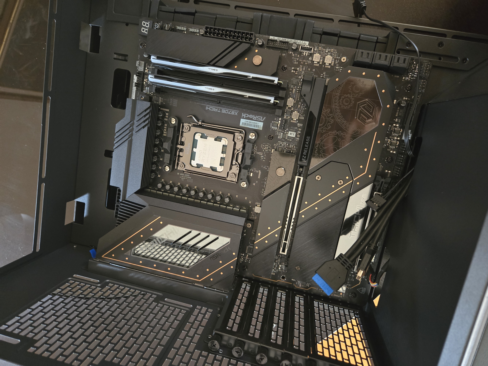

# Custom Workstation Build

A high-performance workstation built on the AMD AM5 platform, with components chosen for compatibility, thermals, power delivery, and long-term reliability. Dual-boots Windows 11 Pro and Ubuntu Linux.

## Parts List
| Component | Part |
|---|---|
| CPU | AMD Ryzen 7 7800X3D (8 cores / 16 threads, 3D V-Cache) |
| Motherboard | ASRock X870E Taichi |
| Memory | 32 GB DDR5-6000 |
| GPU | XFX AMD Radeon RX 9070 XT |
| Storage | WD 1TB M.2 NVMe SSD (OS & applications) + WD 4TB HDD (bulk storage) |
| CPU Cooler | Lian Li HydroShift [size, e.g. 360mm] AIO liquid cooler |
| Power Supply | Corsair RM1000 1000W, fully modular |
| Case | Phanteks NV5 |

## Design Considerations
I approached this build the way I'd approach a customer solution: start with the workload, then pick hardware that fits it.

- **Workload fit:** I chose the 7800X3D because its 3D V-Cache suits cache-sensitive workloads. Picking a processor for the use case, rather than for headline specs, was the central decision.
- **Thermal design:** the Lian Li HydroShift AIO and the Phanteks NV5's dual-chamber layout keep heat-producing parts apart and airflow clean. That keeps temperatures stable under sustained load, so the system holds its performance instead of throttling.
- **Power budgeting:** the 1000W Corsair PSU leaves wide headroom above peak system draw, so power delivery stays stable under load and tuning and there's room for future upgrades.
- **Cable management:** the fully modular PSU means only the cables the system needs are installed, which cuts clutter and improves airflow in the dual-chamber case.
- **Expandability and I/O:** the X870E Taichi's PCIe 5.0, USB4, and strong VRM design allow the system to grow without replacing the platform.
- **Compatibility:** I checked CPU, motherboard, memory, GPU clearance, and cooler fitment against one another before buying, to avoid integration issues at assembly.
- **Tiered storage:** a fast NVMe SSD for the operating systems and applications, paired with a high-capacity HDD for bulk data, balances speed, capacity, and cost.

## Firmware & OS Configuration
- UEFI with Secure Boot enabled
- Dual-boot: Windows 11 Pro and Ubuntu Linux
- Virtualization-based security and Hyper-V enabled
- DDR5-6000 memory running at rated speed via EXPO profile

## Performance Tuning & Validation
- Tuned CPU performance using [PBO / Curve Optimizer, whatever you used]
- Stress-tested for stability and thermals with [tools, e.g. Cinebench, OCCT, MemTest86]

## What I Learned
- Thermals and power delivery matter as much as raw specs. A system is only as reliable as its weakest constraint.
- Working through firmware, Secure Boot, and dual-boot configuration taught me how hardware, firmware, and operating systems interact.
- Validating stability after every change matters before trusting a system with real workloads.
